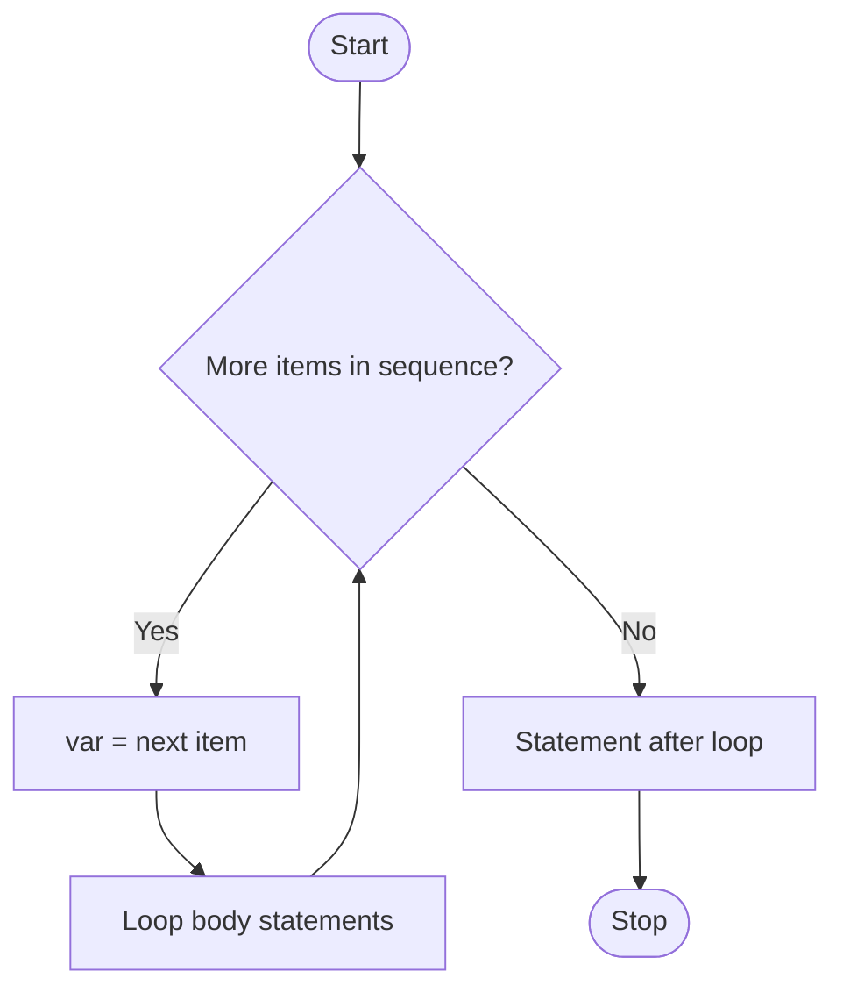

# Section 15: Python `for` Loop & `range()`
### Beginner → Advanced Notes

---

## Table of Contents
1. [Introduction](#1-introduction)
2. [range() Function](#2-range-function)
3. [for Loop: Syntax, Working, Flow Chart](#3-for-loop-syntax-working-flow-chart)
4. [Looping over Strings, Lists and More](#4-looping-over-strings-lists-and-more)
5. [Sum of n Natural Numbers](#5-sum-of-n-natural-numbers)
6. [Factorial of a Number](#6-factorial-of-a-number)
7. [Fibonacci Series](#7-fibonacci-series)
8. [Factors of a Number](#8-factors-of-a-number)
9. [Check if a Number is Prime](#9-check-if-a-number-is-prime)
10. [More about the for Loop: break, continue, pass, else](#10-more-about-the-for-loop-break-continue-pass-else)
11. [Nested for Loops](#11-nested-for-loops)
12. [Useful Helpers: enumerate, zip, reversed](#12-useful-helpers-enumerate-zip-reversed)
13. [Common Mistakes](#13-common-mistakes)
14. [Practice Questions](#14-practice-questions)

---

## 1. Introduction

### Beginner level

A `for` loop repeats a block of statements **once for each item** in a sequence. That is why it is called a **for-each loop**.

```python
for i in range(3):
    print("Hello")
```

```
Hello
Hello
Hello
```

| Use a `for` loop when...                         | Example                                  |
|--------------------------------------------------|------------------------------------------|
| you know **how many times** to repeat            | print a table up to 10                   |
| you want to go through **every item** in a collection | each character of a string, each item of a list |

The most common partner of `for` is the built-in function **`range()`**, which generates numbers.

---

## 2. range() Function

### Syntax

```python
range(start, stop, step)
```

| Parameter | Required? | Default | Meaning                                  |
|-----------|-----------|---------|------------------------------------------|
| `start`   | optional  | `0`     | first number                             |
| `stop`    | **required** | none | number to stop **before** (never included) |
| `step`    | optional  | `1`     | gap between numbers (can be negative)    |

> ✅ **Golden rule:** the `stop` value is **never** included.

### Three forms

| Form                       | Meaning                              |
|----------------------------|--------------------------------------|
| `range(stop)`              | `0` up to `stop - 1`                 |
| `range(start, stop)`       | `start` up to `stop - 1`             |
| `range(start, stop, step)` | `start`, `start+step`, ... before `stop` |

### Examples

| Call                | Values produced            | Note                         |
|---------------------|----------------------------|------------------------------|
| `range(5)`          | `0, 1, 2, 3, 4`            | start defaults to 0          |
| `range(1, 5)`       | `1, 2, 3, 4`               |                              |
| `range(6, 11)`      | `6, 7, 8, 9, 10`           |                              |
| `range(0, 10, 2)`   | `0, 2, 4, 6, 8`            | even numbers                 |
| `range(1, 10, 2)`   | `1, 3, 5, 7, 9`            | odd numbers                  |
| `range(-5, -1)`     | `-5, -4, -3, -2`           | negatives work               |
| `range(-2, 3)`      | `-2, -1, 0, 1, 2`          | **3 is not included**        |
| `range(10, 5, -1)`  | `10, 9, 8, 7, 6`           | negative step = count down   |
| `range(5, 0)`       | *(empty)*                  | step is +1 but start > stop  |

> 📝 In your notes `range(-2, 3)` was listed as ending with `3`. It actually ends at `2`.

### See the values

`range()` does not print a list by itself. Convert it:

```python
print(list(range(5)))          # [0, 1, 2, 3, 4]
print(list(range(10, 5, -1)))  # [10, 9, 8, 7, 6]
```

### Intermediate level

- `range` only accepts **integers**. `range(0, 1, 0.1)` gives a `TypeError`.
- `step` cannot be `0` (`ValueError`).
- To count **down**, `start` must be bigger than `stop` **and** `step` must be negative.
- Handy properties:

```python
r = range(0, 10, 3)
print(len(r))        # 4   -> 0, 3, 6, 9
print(r[2])          # 6   (indexing works)
print(9 in r)        # True
print(r[::-1])       # range(9, -1, -3)
```

### Advanced level

- In Python 3, `range` is a **lazy sequence object**. It does not store all numbers, so `range(10**12)` uses almost no memory.
- Floating-point steps: use a comprehension or `numpy.arange`.

```python
values = [i / 10 for i in range(0, 11)]   # 0.0, 0.1, ... 1.0
```

---

## 3. for Loop: Syntax, Working, Flow Chart

### Syntax

```python
for <var> in <sequence>:
    statement 1
    statement 2
statement 3          # outside the loop
```

### Working (control flow)

1. Take the **next item** from the sequence and store it in `<var>`.
2. Run the loop body.
3. Repeat until the sequence has **no more items**.
4. Then continue with the statement after the loop.

### Flow chart



Text version:

```
Start
  |
  v
+-> any items left? --- No ---> next statement --> Stop
|        |
|       Yes
|        |
|   var = next item
|        |
+--- run loop body
```

### Example

```python
for i in range(5):
    print(i)
```

```
0
1
2
3
4
```

| Round | `i` |
|-------|-----|
| 1     | 0   |
| 2     | 1   |
| 3     | 2   |
| 4     | 3   |
| 5     | 4   |

> A `for` loop updates its variable **automatically**. You do not write `i = i + 1` like in a `while` loop.

---

## 4. Looping over Strings, Lists and More

### Strings

```python
s1 = 'python'
for x in s1:
    print(x)
```

```
p
y
t
h
o
n
```

### Lists and tuples

```python
numbers = [7, 41, 6, 64, 93]
for n in numbers:
    print(n)
```

### Dictionary

```python
student = {"name": "Asha", "age": 21}

for key in student:                       # keys
    print(key)

for key, value in student.items():        # key and value
    print(key, "->", value)
```

### Loop with index

```python
s = "abc"
for i in range(len(s)):
    print(i, s[i])
# 0 a
# 1 b
# 2 c
```

> Advanced tip: the loop variable is just a normal variable and remains after the loop ends. After `for i in range(3): pass`, `i` is `2`.

---

## 5. Sum of n Natural Numbers

Natural numbers: `1, 2, 3, ..., n`.

```python
n = 5
total = 0
for x in range(1, n + 1):
    total = total + x
print(total)        # 15
```

**Trace:**

| `x` | `total` after adding |
|-----|----------------------|
| 1   | 1                    |
| 2   | 3                    |
| 3   | 6                    |
| 4   | 10                   |
| 5   | 15                   |

> ⚠️ Use the **same name** for the loop variable and the one you add. Your note had `for x in ...` but added `i`, which would cause an error. Also avoid the name `sum` because it hides Python's built-in `sum()`.

### Why `range(1, n + 1)`?

Because `stop` is excluded. `range(1, n)` would stop at `n - 1`.

### Shortcuts

```python
print(sum(range(1, n + 1)))     # 15 using built-in sum
print(n * (n + 1) // 2)         # 15 using the formula
```

### Variations

```python
# sum of even numbers up to n
total = 0
for x in range(2, n + 1, 2):
    total += x

# sum of squares
total = 0
for x in range(1, n + 1):
    total += x * x
```

---

## 6. Factorial of a Number

### Concept

```
n! = 1 x 2 x 3 x ... x n
5! = 1 x 2 x 3 x 4 x 5 = 120
0! = 1   (by definition)
```

### Program

```python
n = 5
fact = 1
for i in range(1, n + 1):
    fact = fact * i
print(fact)         # 120
```

**Trace:**

| `i` | `fact`          |
|-----|-----------------|
| 1   | 1 x 1 = 1       |
| 2   | 1 x 2 = 2       |
| 3   | 2 x 3 = 6       |
| 4   | 6 x 4 = 24      |
| 5   | 24 x 5 = 120    |

> ⚠️ Start `fact = 1`, **not** `0`. Multiplying by 0 always gives 0 (but starting the sum at 0 is correct for addition).

### Advanced

- For `n = 0`, `range(1, 1)` is empty, so `fact` stays `1`. That is correct.
- Factorial is not defined for negative numbers, so check input first.
- Built-in: `math.factorial(5)`.
- Python integers have no size limit, so `factorial(100)` is exact.

---

## 7. Fibonacci Series

### Concept

Each term is the **sum of the previous two**. The series starts with `0` and `1`.

First 11 terms:

```
0  1  1  2  3  5  8  13  21  34  55
```

### Mathematical definition

```
fib(0) = 0
fib(1) = 1
fib(n) = fib(n - 1) + fib(n - 2)      for n >= 2
```

| n      | 0 | 1 | 2 | 3 | 4 | 5 | 6 | 7  | 8  | 9  | 10 |
|--------|---|---|---|---|---|---|---|----|----|----|----|
| fib(n) | 0 | 1 | 1 | 2 | 3 | 5 | 8 | 13 | 21 | 34 | 55 |

> ⚠️ Your note had `fib(n-1) - fib(n-2)`. It is a **plus**, not a minus.

### Program

```python
n = 11               # number of terms
a = 0
b = 1
for i in range(n):
    print(a, end=" ")
    c = a + b
    a = b
    b = c
```

Output: `0 1 1 2 3 5 8 13 21 34 55`

> ⚠️ Two fixes to your version: (1) `n` must be the **number of terms** (it was set to `0`, so the loop would not run); (2) **print `a` first**, then update. If you print after updating, the first `0` is lost.

**Trace (first rounds):**

| Round | print `a` | `c = a + b` | `a` | `b` |
|-------|-----------|-------------|-----|-----|
| 1     | 0         | 1           | 1   | 1   |
| 2     | 1         | 2           | 1   | 2   |
| 3     | 1         | 3           | 2   | 3   |
| 4     | 2         | 5           | 3   | 5   |

### Shorter version (tuple swap)

```python
a, b = 0, 1
for _ in range(11):
    print(a, end=" ")
    a, b = b, a + b
```

`_` is the convention for a loop variable you do not use.

### Advanced

- Recursion (`fib(n-1) + fib(n-2)`) works but is very slow for large `n` (repeated work). The loop version is **O(n)**.
- A generator version:

```python
def fib(n):
    a, b = 0, 1
    for _ in range(n):
        yield a
        a, b = b, a + b

print(list(fib(11)))
```

---

## 8. Factors of a Number

A **factor** divides the number **exactly** (remainder `0`).

```python
n = 15
for i in range(1, n + 1):
    if n % i == 0:
        print(i)
```

Output: `1 3 5 15`

> Your note was missing the `print(i)` line and the colon at the end of the `if`.

### Count the factors

```python
n = 15
count = 0
for i in range(1, n + 1):
    if n % i == 0:
        count += 1
print(count)        # 4
```

### Advanced: faster method

Factors come in **pairs**, so you only need to check up to the square root.

```python
import math

n = 36
factors = set()
for i in range(1, math.isqrt(n) + 1):
    if n % i == 0:
        factors.add(i)
        factors.add(n // i)
print(sorted(factors))   # [1, 2, 3, 4, 6, 9, 12, 18, 36]
```

---

## 9. Check if a Number is Prime

A **prime number** has **exactly 2 factors**: `1` and itself.
Examples: 2, 3, 5, 7, 11, 13. (`1` is **not** prime.)

### Method 1: count the factors

```python
n = 7
count = 0
for i in range(1, n + 1):
    if n % i == 0:
        count += 1

if count == 2:
    print("prime")
else:
    print("not prime")
```

Output: `prime`

> ⚠️ Your note used `n % 2 == 0` inside the loop. It must be **`n % i == 0`**, because we test every `i`. Also fix the typos in the messages (`"print"` / `"not priente'`) and add the colon after `else`.

### Method 2: stop early with `break` and `for-else`

```python
n = 29
if n < 2:
    print("not prime")
else:
    for i in range(2, n):
        if n % i == 0:
            print("not prime")
            break
    else:
        print("prime")     # runs only when the loop was NOT broken
```

### Method 3: advanced (check only up to square root)

```python
import math

n = 97
if n < 2:
    print("not prime")
else:
    for i in range(2, math.isqrt(n) + 1):
        if n % i == 0:
            print("not prime")
            break
    else:
        print("prime")
```

| Method          | Checks (for n = 97) | Speed          |
|-----------------|---------------------|----------------|
| 1. count factors| 97 numbers          | slowest        |
| 2. early break  | up to 95 numbers    | faster         |
| 3. square root  | 8 numbers (2 to 9)  | fastest        |

### All primes in a range

```python
for n in range(2, 30):
    for i in range(2, n):
        if n % i == 0:
            break
    else:
        print(n, end=" ")
# 2 3 5 7 11 13 17 19 23 29
```

---

## 10. More about the for Loop: break, continue, pass, else

### break statement

`break` **comes out of the loop** immediately.

```python
for i in range(0, n):
    statement 1
    if <condition>:
        break
    statement 2
statement 3          # runs after break
```

```python
for i in range(1, 11):
    if i == 5:
        break
    print(i)
```

Output: `1 2 3 4`

Typical use: **stop searching** once the item is found.

```python
names = ["Asha", "Ravi", "Meena"]
for name in names:
    if name == "Ravi":
        print("found")
        break
```

### continue statement

`continue` **skips the rest of the current round** and moves to the next item.

```python
for i in range(0, n):
    statement 1
    if <condition>:
        continue
    statement 2       # skipped when the condition is True
statement 3
```

```python
for i in range(1, 11):
    if i % 3 == 0:
        continue
    print(i)
```

Output: `1 2 4 5 7 8 10`

> Unlike a `while` loop, `continue` in a `for` loop is **safe** from infinite loops, because the next item is taken automatically.

### pass statement

`pass` **does nothing**. It is a placeholder where Python needs a statement.

```python
for i in range(0, n):
    pass        # TODO: write the code later
```

```python
for i in range(5):
    if i == 2:
        pass          # nothing happens, loop goes on normally
    print(i)          # 0 1 2 3 4
```

> Note: in Python the comment symbol is `#` (not `//`).

### else suite with for

```python
for i in range(0, n):
    statement 1
else:
    statement 2        # runs when the loop finishes normally
```

| How the loop ended           | Does `else` run? |
|------------------------------|------------------|
| All items processed          | ✅ Yes           |
| Stopped by `break`           | ❌ No            |

```python
for i in range(5):
    if i == 3:
        break
    print(i)
else:
    print("end of loop")
print("end of program")
```

Output:

```
0
1
2
end of program
```

Without the `break`, the output would be `0 1 2 3 4`, `end of loop`, `end of program`.

### Quick comparison

| Statement  | Effect                              | Loop keeps running? |
|------------|-------------------------------------|---------------------|
| `break`    | leave the loop                      | No                  |
| `continue` | skip to the next item               | Yes                 |
| `pass`     | do nothing                          | Yes                 |
| `else`     | block that runs if no `break` happened | n/a              |

---

## 11. Nested for Loops

A loop **inside** another loop. The inner loop runs fully for every round of the outer loop.

```python
for i in range(1, 4):
    for j in range(1, 4):
        print(i * j, end=" ")
    print()
```

```
1 2 3
2 4 6
3 6 9
```

### Star triangle

```python
n = 4
for i in range(1, n + 1):
    print("* " * i)
```

```
* 
* * 
* * * 
* * * * 
```

### Advanced notes

- Total rounds = outer count x inner count (here 3 x 3 = 9).
- `break` only exits the **inner** loop. To exit both, use a flag variable or put the loops in a function and `return`.

---

## 12. Useful Helpers: enumerate, zip, reversed

```python
fruits = ["apple", "banana", "cherry"]

# index + value
for i, fruit in enumerate(fruits, start=1):
    print(i, fruit)

# two lists together
prices = [100, 40, 90]
for fruit, price in zip(fruits, prices):
    print(fruit, price)

# backwards
for fruit in reversed(fruits):
    print(fruit)

# sorted order
for fruit in sorted(fruits):
    print(fruit)
```

---

## 13. Common Mistakes

| Mistake                                   | Fix                                           |
|-------------------------------------------|-----------------------------------------------|
| Expecting `range(1, 5)` to include 5      | use `range(1, 6)`                             |
| Using different names (`x` in loop, `i` in body) | use one consistent variable            |
| Starting factorial with `0`               | start with `1`                                |
| Wrong sign in Fibonacci                   | `fib(n) = fib(n-1) + fib(n-2)`                |
| Printing `a` after updating it            | print first, then update                      |
| `n % 2` instead of `n % i` in prime check | divide by the loop variable `i`               |
| Missing `:` after `for`, `if`, `else`     | every block header ends with a colon          |
| Floating-point in `range()`               | `range` accepts integers only                 |
| Counting down without a negative step     | `range(10, 0, -1)`                            |
| Modifying a list while looping over it    | loop over a copy: `for x in lst[:]:`          |

---

## 14. Practice Questions

Predict the output before running.

```python
# 1
for i in range(3, 0, -1):
    print(i)

# 2
print(list(range(-2, 3)))

# 3
for i in range(1, 10):
    if i % 4 == 0:
        break
    print(i)

# 4
for i in range(5):
    if i == 2:
        continue
    print(i)

# 5
for i in range(3):
    print(i)
else:
    print("done")

# 6
print(len(range(0, 10, 3)))

# 7
print(sum(range(1, 6)))

# 8
print(list(range(5, 0)))
```

<details>
<summary>Answers</summary>

1. `3 2 1`
2. `[-2, -1, 0, 1, 2]`
3. `1 2 3` (break at 4)
4. `0 1 3 4`
5. `0 1 2 done`
6. `4` (values 0, 3, 6, 9)
7. `15`
8. `[]` (default step is +1, and 5 > 0, so nothing is produced)

</details>

### Mini challenges

1. Print the multiplication table of any number using `for`.
2. Print all even numbers from 1 to 50.
3. Count the vowels in a string.
4. Find the sum of the digits of a number (hint: convert to string, or use a `while` loop).
5. Print all prime numbers between 1 and 100.
6. Check whether a number is an **Armstrong number** (e.g. 153 = 1³ + 5³ + 3³).
7. Print the pattern below:

```
1
1 2
1 2 3
1 2 3 4
```
