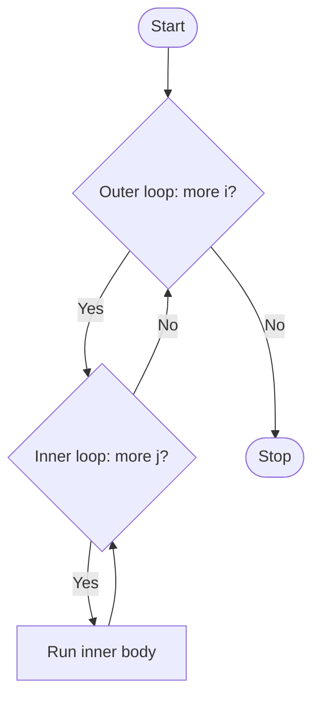

# Python Nested Loops & Pattern Programs
### Beginner → Advanced Notes

---

## Table of Contents
1. [What is a Nested Loop?](#1-what-is-a-nested-loop)
2. [How Nested Loops Execute](#2-how-nested-loops-execute)
3. [Printing Styles (end, sep, f-strings)](#3-printing-styles-end-sep-f-strings)
4. [Prime Numbers from 1 to 100](#4-prime-numbers-from-1-to-100)
5. [Pattern Programs: The Method](#5-pattern-programs-the-method)
6. [Star Patterns](#6-star-patterns)
7. [Number and Alphabet Patterns](#7-number-and-alphabet-patterns)
8. [break and continue in Nested Loops](#8-break-and-continue-in-nested-loops)
9. [More Nested Loop Programs](#9-more-nested-loop-programs)
10. [Advanced Topics](#10-advanced-topics)
11. [Common Mistakes](#11-common-mistakes)
12. [Practice Questions](#12-practice-questions)

---

## 1. What is a Nested Loop?

### Beginner level

A **nested loop** is a **loop inside another loop**.

- The first loop is the **outer loop**.
- The loop inside it is the **inner loop**.

A single loop:

```python
for i in range(1, 4):
    print(i)
```

```
1
2
3
```

A nested loop:

```python
for i in range(1, 4):
    for j in range(1, 4):
        print(i, '-', j)
```

```
1 - 1
1 - 2
1 - 3
2 - 1
2 - 2
2 - 3
3 - 1
3 - 2
3 - 3
```

### Golden rule

> For **every one round** of the outer loop, the inner loop runs **completely** (all its rounds).

Total rounds = outer rounds x inner rounds = 3 x 3 = **9**.

---

## 2. How Nested Loops Execute

### Flow chart



### Trace table

```python
for i in range(1, 4):
    for j in range(1, 4):
        print(i, '-', j)
```

| Outer `i` | Inner `j` values   | Printed                  |
|-----------|--------------------|--------------------------|
| 1         | 1, 2, 3            | `1-1`, `1-2`, `1-3`      |
| 2         | 1, 2, 3            | `2-1`, `2-2`, `2-3`      |
| 3         | 1, 2, 3            | `3-1`, `3-2`, `3-3`      |

Think of a **clock**: the minute hand (inner) goes all the way round for every single step of the hour hand (outer).

### Indentation decides everything

```python
for i in range(1, 4):
    for j in range(1, 4):
        print(j, end=' ')     # inside inner loop
    print()                   # inside outer loop only (after inner finishes)
print("done")                 # outside both loops
```

---

## 3. Printing Styles (end, sep, f-strings)

By default `print()` ends with a **new line**. Use `end` to change that.

### Print each row on one line

```python
for i in range(1, 4):
    for j in range(1, 4):
        print(i, ',', j, end=' ')
    print('')                 # moves to the next line after each row
```

```
1 , 1 1 , 2 1 , 3
2 , 1 2 , 2 2 , 3
3 , 1 3 , 2 3 , 3
```

> 📝 Your note had `end=')` which is a syntax error. It must be `end=' '` (a space) or `end=''` (nothing).

### Cleaner alternatives

```python
for i in range(1, 4):
    for j in range(1, 4):
        print(i, j, sep=',', end='  ')     # 1,1  1,2  1,3
    print()

for i in range(1, 4):
    for j in range(1, 4):
        print(f"({i},{j})", end=' ')       # (1,1) (1,2) (1,3)
    print()
```

| Option    | Meaning                                   | Default |
|-----------|-------------------------------------------|---------|
| `end=`    | what to print **after** the output        | `'\n'`  |
| `sep=`    | what to put **between** multiple values   | `' '`   |

`print('')` and `print()` both just print a new line.

---

## 4. Prime Numbers from 1 to 100

### Idea

A prime has **exactly 2 factors** (1 and itself). For **each number** `n` from 1 to 100 (outer loop), **count its factors** (inner loop).

### Correct program

```python
for n in range(1, 101):          # outer loop: each number
    count = 0                    # reset for every number
    for i in range(1, n + 1):    # inner loop: test each divisor
        if n % i == 0:
            count += 1
    if count == 2:
        print(n, end=' ')
```

Output:

```
2 3 5 7 11 13 17 19 23 29 31 37 41 43 47 53 59 61 67 71 73 79 83 89 97
```

(25 primes below 100.)

### What was wrong in the draft notes?

```python
n = 100
count = 0
for i in range(1, n+1)
    for n % i == 0:        # ❌
        count += 1
if count == 2
    print(n)
```

| Problem                                   | Fix                                        |
|-------------------------------------------|--------------------------------------------|
| Only checked the single number `100`      | add an **outer loop** `for n in range(1, 101)` |
| `for n % i == 0:` is not valid            | use **`if`** `n % i == 0:`                 |
| `count` set only once                     | **reset `count = 0`** for each `n`         |
| Missing colons after `for` and `if`       | add `:`                                    |

### Faster versions (Intermediate → Advanced)

**Using `break` and `for-else`:**

```python
for n in range(2, 101):
    for i in range(2, n):
        if n % i == 0:
            break
    else:
        print(n, end=' ')       # runs only if no divisor found
```

**Checking only up to the square root:**

```python
import math

for n in range(2, 101):
    for i in range(2, math.isqrt(n) + 1):
        if n % i == 0:
            break
    else:
        print(n, end=' ')
```

| Method                  | Inner-loop work for each n |
|-------------------------|----------------------------|
| Count all factors       | n rounds                   |
| break at first divisor  | up to n - 2 rounds         |
| square-root limit       | about √n rounds            |

---

## 5. Pattern Programs: The Method

### The universal rule

```
Outer loop  ->  controls the ROWS
Inner loop  ->  controls the COLUMNS (what to print in each row)
print()     ->  after the inner loop, moves to the NEXT ROW
```

### Template

```python
for i in range(1, rows + 1):        # each row
    for j in range(1, cols + 1):    # each column in that row
        print('*', end='')
    print()                         # new line after each row
```

### How to solve any pattern (4 questions)

1. How many **rows**? (outer loop range)
2. In row `i`, how many **spaces**?
3. In row `i`, how many **stars / numbers**?
4. Do you print a **new line** after each row?

---

## 6. Star Patterns

All examples use 5 rows.

### Pattern 1: Square

```python
for i in range(1, 6):
    for j in range(1, 6):
        print('*', end='')
    print('')
```

```
*****
*****
*****
*****
*****
```

Add a space (`end=' '`) to make it look more square: `* * * * *`.

### Pattern 2: Right-angled triangle (increasing)

Print `*` only when the column `j` is **not greater than** the row `i`.

```python
for i in range(1, 6):
    for j in range(1, 6):
        if i >= j:
            print('*', end='')
    print('')
```

```
*
**
***
****
*****
```

**Better version:** let the inner loop run only `i` times.

```python
for i in range(1, 6):
    for j in range(1, i + 1):
        print('*', end='')
    print()
```

**Shortcut using string repetition** (no inner loop needed):

```python
for i in range(1, 6):
    print('*' * i)
```

> 📝 Your note had `print('*', * i )`, which is invalid. The correct form is `print('*' * i)`.

| Row `i` | Stars |
|---------|-------|
| 1       | 1     |
| 2       | 2     |
| 3       | 3     |
| 4       | 4     |
| 5       | 5     |

### Pattern 3: Inverted right triangle

Row 1 has 5 stars, row 2 has 4, ... row 5 has 1. So row `i` has `6 - i` stars, which is `6 - (i - 1) - 1 + 1` → the inner range ends at `6 - (i - 1)`.

```python
for i in range(1, 6):
    for j in range(1, 6 - (i - 1)):
        print('*', end='')
    print('')
```

```
*****
****
***
**
*
```

Simplified: `for j in range(1, 7 - i)` or `print('*' * (6 - i))`.

| Row `i` | Inner range              | Stars |
|---------|--------------------------|-------|
| 1       | `range(1, 6)`            | 5     |
| 2       | `range(1, 5)`            | 4     |
| 3       | `range(1, 4)`            | 3     |
| 4       | `range(1, 3)`            | 2     |
| 5       | `range(1, 2)`            | 1     |

### Pattern 4: Right-aligned inverted triangle (with spaces)

Row `i` needs `i - 1` spaces, then `6 - i` stars.

```python
for i in range(1, 6):
    print(" " * (i - 1) + "*" * (6 - i))
```

```
*****
 ****
  ***
   **
    *
```

> 📝 Your note had `" " * (i-6)`. A **negative** repeat count gives an empty string (no spaces at all). The spaces must be `(i - 1)` here. Also the line must be one `print(...)` with the correct brackets and a `+` between the spaces and the stars.

In the same two-loop style:

```python
for i in range(1, 6):
    for s in range(1, i):            # i - 1 spaces
        print(' ', end='')
    for j in range(1, 6 - (i - 1)):  # 6 - i stars
        print('*', end='')
    print()
```

### Pattern 5: Right-aligned triangle (increasing)

Row `i` needs `5 - i` spaces, then `i` stars.

```python
for i in range(1, 6):
    print(" " * (5 - i) + "*" * i)
```

```
    *
   **
  ***
 ****
*****
```

### Pattern 6: Pyramid

Row `i` needs `5 - i` spaces and `2i - 1` stars.

```python
for i in range(1, 6):
    print(" " * (5 - i) + "*" * (2 * i - 1))
```

```
    *
   ***
  *****
 *******
*********
```

### Pattern 7: Inverted pyramid

Row `i` needs `i - 1` spaces and `11 - 2i` stars.

```python
for i in range(1, 6):
    print(" " * (i - 1) + "*" * (11 - 2 * i))
```

```
*********
 *******
  *****
   ***
    *
```

### Pattern 8: Diamond

Pyramid on top, then an inverted pyramid **without repeating the middle row**.

```python
n = 5
for i in range(1, n + 1):
    print(" " * (n - i) + "*" * (2 * i - 1))
for i in range(n - 1, 0, -1):
    print(" " * (n - i) + "*" * (2 * i - 1))
```

```
    *
   ***
  *****
 *******
*********
 *******
  *****
   ***
    *
```

### Pattern 9: Hollow square

Print `*` only on the **border** (first/last row or first/last column).

```python
n = 5
for i in range(1, n + 1):
    for j in range(1, n + 1):
        if i == 1 or i == n or j == 1 or j == n:
            print('*', end=' ')
        else:
            print(' ', end=' ')
    print()
```

```
* * * * * 
*       * 
*       * 
*       * 
* * * * * 
```

### Formula summary (n = number of rows)

| Pattern                    | Spaces in row `i` | Stars in row `i` |
|----------------------------|-------------------|------------------|
| Square                     | 0                 | `n`              |
| Right triangle             | 0                 | `i`              |
| Inverted triangle          | 0                 | `n - i + 1`      |
| Right-aligned triangle     | `n - i`           | `i`              |
| Right-aligned inverted     | `i - 1`           | `n - i + 1`      |
| Pyramid                    | `n - i`           | `2i - 1`         |
| Inverted pyramid           | `i - 1`           | `2(n - i) + 1`   |

---

## 7. Number and Alphabet Patterns

### Numbers 1 to i in each row

```python
for i in range(1, 6):
    for j in range(1, i + 1):
        print(j, end=' ')
    print()
```

```
1 
1 2 
1 2 3 
1 2 3 4 
1 2 3 4 5 
```

### Row number repeated

```python
for i in range(1, 6):
    for j in range(1, i + 1):
        print(i, end=' ')
    print()
```

```
1 
2 2 
3 3 3 
4 4 4 4 
5 5 5 5 5 
```

### Floyd's triangle (running counter)

```python
num = 1
for i in range(1, 6):
    for j in range(1, i + 1):
        print(num, end=' ')
        num += 1
    print()
```

```
1 
2 3 
4 5 6 
7 8 9 10 
11 12 13 14 15 
```

### Alphabet triangle

```python
for i in range(1, 6):
    for j in range(i):
        print(chr(65 + j), end=' ')     # 65 is 'A'
    print()
```

```
A 
A B 
A B C 
A B C D 
A B C D E 
```

### Multiplication table grid

```python
for i in range(1, 6):
    for j in range(1, 6):
        print(f"{i * j:3}", end='')     # width 3 for alignment
    print()
```

```
  1  2  3  4  5
  2  4  6  8 10
  3  6  9 12 15
  4  8 12 16 20
  5 10 15 20 25
```

---

## 8. break and continue in Nested Loops

### `break` exits only the inner loop

```python
for i in range(1, 4):
    for j in range(1, 4):
        if j == 2:
            break
        print(i, j)
```

```
1 1
2 1
3 1
```

The inner loop stops at `j == 2`, but the **outer loop carries on**.

### `continue` skips one inner round

```python
for i in range(1, 4):
    for j in range(1, 4):
        if j == 2:
            continue
        print(i, j)
```

```
1 1
1 3
2 1
2 3
3 1
3 3
```

### Exit BOTH loops (Advanced)

**Option 1: flag variable**

```python
found = False
for i in range(1, 5):
    for j in range(1, 5):
        if i * j == 6:
            print(i, j)          # 2 3
            found = True
            break
    if found:
        break
```

**Option 2: put the loops in a function and `return`**

```python
def find_pair():
    for i in range(1, 5):
        for j in range(1, 5):
            if i * j == 6:
                return i, j

print(find_pair())     # (2, 3)
```

**Option 3: `for-else` trick**

```python
for i in range(1, 5):
    for j in range(1, 5):
        if i * j == 6:
            print(i, j)
            break
    else:
        continue      # inner loop did NOT break -> keep going
    break             # inner loop broke -> break the outer loop too
```

---

## 9. More Nested Loop Programs

### Work with a 2D list (matrix)

```python
matrix = [
    [1, 2, 3],
    [4, 5, 6],
    [7, 8, 9],
]

for row in matrix:
    for value in row:
        print(value, end=' ')
    print()

total = 0
for row in matrix:
    for value in row:
        total += value
print(total)              # 45
```

### Unique pairs (inner range depends on outer variable)

```python
for i in range(1, 5):
    for j in range(i + 1, 5):
        print((i, j), end=' ')
# (1, 2) (1, 3) (1, 4) (2, 3) (2, 4) (3, 4)
```

### Count how many times the inner body runs

```python
count = 0
for i in range(1, 6):
    for j in range(1, i + 1):
        count += 1
print(count)       # 15  ->  1+2+3+4+5 = n(n+1)/2
```

### Armstrong / perfect-number style search between 1 and 1000 (idea)

Outer loop picks the number, inner loop (or a `while` loop) tests it, just like the prime example.

---

## 10. Advanced Topics

### 1. Time cost grows fast

| Nesting depth | Rounds (n = 1000) |
|---------------|-------------------|
| 1 loop        | 1,000             |
| 2 nested      | 1,000,000         |
| 3 nested      | 1,000,000,000     |

Two nested loops are **O(n²)**, three are **O(n³)**. Avoid deep nesting on big data when a better method exists (sets, dictionaries, math formulas).

### 2. `itertools.product` replaces nested loops

```python
from itertools import product

for i, j in product(range(1, 4), range(1, 4)):
    print(i, j)
```

### 3. Nested comprehension

```python
pairs = [(i, j) for i in range(1, 4) for j in range(1, 4)]
table = [[i * j for j in range(1, 6)] for i in range(1, 6)]
```

The **order** in the comprehension matches the nested `for` order (outer first).

### 4. Never reuse the same variable name

```python
for i in range(3):
    for i in range(3):      # ❌ overwrites the outer i
        print(i)
```

### 5. Nested `while` and mixed loops

```python
i = 1
while i <= 3:
    for j in range(1, 4):
        print(i * j, end=' ')
    print()
    i += 1
```

---

## 11. Common Mistakes

| Mistake                                      | Fix                                          |
|----------------------------------------------|----------------------------------------------|
| `for n % i == 0:`                            | use `if n % i == 0:`                         |
| Forgetting to reset `count = 0` for each number | put `count = 0` **inside** the outer loop |
| `print()` placed inside the inner loop       | put it **after** the inner loop (outer level)|
| Missing `end=''` so everything prints vertically | add `end=''` or `end=' '`               |
| `print('*', * i)`                            | `print('*' * i)`                             |
| `" " * (i - 6)` (negative count)             | gives `''`; use the correct positive count   |
| `end=')`                                     | `end=' '`                                    |
| Typos `rnage`, `pirnt`                       | `range`, `print`                             |
| Missing colon or wrong indentation           | every `for`/`if`/`else` ends with `:`, indent consistently |
| Off-by-one with `range`                      | stop value is excluded: use `range(1, n + 1)`|
| Using the same variable in both loops        | use different names (`i`, `j`, `k`)          |

---

## 12. Practice Questions

Predict the output before running.

```python
# 1
for i in range(1, 4):
    for j in range(1, 3):
        print(i * j, end=' ')

# 2
count = 0
for i in range(3):
    for j in range(4):
        count += 1
print(count)

# 3
for i in range(1, 4):
    for j in range(i):
        print(j, end=' ')
    print()

# 4
print(" " * -3 == "")

# 5
for i in range(3):
    for j in range(3):
        if i == j:
            continue
        print(i, j, end='; ')

# 6
count = 0
for i in range(1, 6):
    for j in range(i, 6):
        count += 1
print(count)
```

<details>
<summary>Answers</summary>

1. `1 2 2 4 3 6`
2. `12` (3 x 4)
3. Three lines:
   ```
   0
   0 1
   0 1 2
   ```
4. `True` (a negative repeat count gives an empty string)
5. `0 1; 0 2; 1 0; 1 2; 2 0; 2 1;`
6. `15` (5 + 4 + 3 + 2 + 1)

</details>

### Mini challenges

1. Print the multiplication tables from 1 to 10 using nested loops.
2. Print the hollow right-angled triangle.
3. Print this number pyramid:

```
    1
   121
  12321
 1234321
```

4. Print this pattern:

```
1 2 3 4 5
1 2 3 4
1 2 3
1 2
1
```

5. Print all pairs `(i, j)` where `i + j == 10` and both are between 1 and 9.
6. Print all prime numbers between 1 and 500 using the square-root method.
7. Print Pascal's triangle for 5 rows.
