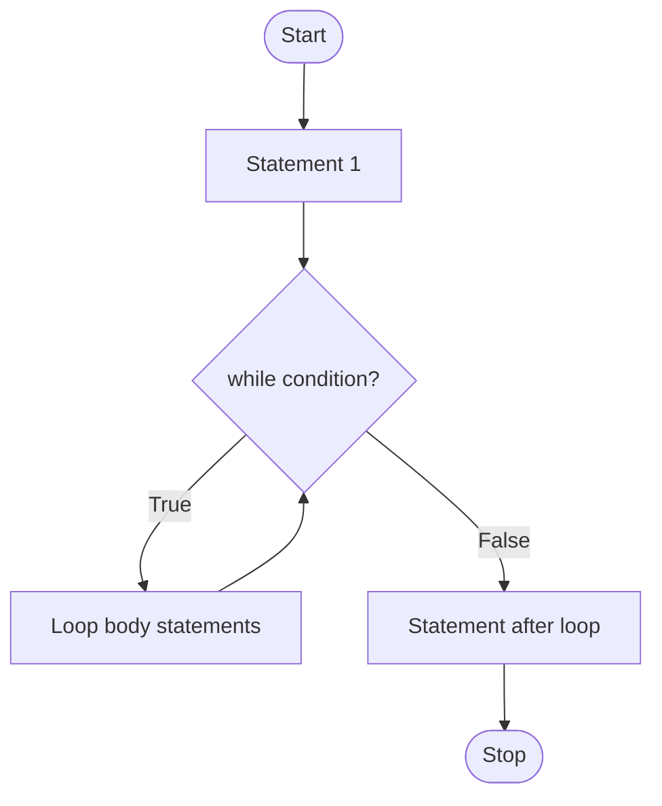

# Python Loops & Control Flow
### Beginner → Advanced Notes

---

## Table of Contents
1. [What is a Loop?](#1-what-is-a-loop)
2. [while Loop](#2-while-loop)
3. [Counter Pattern](#3-counter-pattern)
4. [Working with Digits of a Number](#4-working-with-digits-of-a-number)
5. [Summation Logic](#5-summation-logic)
6. [Finding Max and Min](#6-finding-max-and-min)
7. [Infinite Loops](#7-infinite-loops)
8. [break Statement](#8-break-statement)
9. [continue Statement](#9-continue-statement)
10. [else with while](#10-else-with-while)
11. [for Loop](#11-for-loop)
12. [pass Statement](#12-pass-statement)
13. [match-case](#13-match-case)
14. [while vs for](#14-while-vs-for)
15. [Common Mistakes](#15-common-mistakes)
16. [Practice Questions](#16-practice-questions)

---

## 1. What is a Loop?

### Beginner level

A **loop** is used to **repeat statements** without writing them again and again.

Python has two loops:

| Loop         | Also known as    | Best used when                               |
|--------------|------------------|----------------------------------------------|
| `while` loop | sentinel loop    | you repeat **until a condition becomes False** (number of repeats unknown) |
| `for` loop   | for-each loop    | you repeat **for each item** in a collection or a fixed number of times |

Both can do the same repeating work. The choice is about which is more natural.

Three tools change how a loop behaves:

| Statement  | Effect                                              |
|------------|-----------------------------------------------------|
| `break`    | come **out** of the loop completely                 |
| `continue` | **skip** the rest of this round, go to the next     |
| `pass`     | **do nothing** (placeholder)                        |

---

## 2. while Loop

### Syntax

```python
while <condition>:
    statement 1
    statement 2
statement 3          # outside the loop (not indented)
```

> ✅ Indentation decides which statements are **inside** the loop.

### Control flow

1. Check the condition.
2. If **True** → run the loop body, then go back to step 1.
3. If **False** → leave the loop and run the next statement after it.

### Flow chart



Text version:

```
Start
  |
Statement 1
  |
  v
+-> while condition ---- False ---> Statement after loop --> Stop
|        |
|      True
|        |
+-- loop body
```

### Example: countdown

Without a loop you must repeat code:

```python
n = 5
print(n)
n = n - 1     # decrement the counter
print(n)
n = n - 1
```

With a loop:

```python
n = 5
while n > 0:
    print(n)
    n = n - 1
```

Output:

```
5
4
3
2
1
```

### Three things every while loop needs

| Part                | In the example   |
|---------------------|------------------|
| 1. Initialisation   | `n = 5`          |
| 2. Condition        | `n > 0`          |
| 3. Update           | `n = n - 1`      |

> ⚠️ If you forget the update, the condition never becomes False and you get an **infinite loop**.

### Shortcut operators

```python
n -= 1     # same as n = n - 1
i += 1     # same as i = i + 1
```

---

## 3. Counter Pattern

A **counter** is a variable that counts how many times something happened. It starts at 0 and changes by a fixed step.

### Multiplication table

```python
n = 3
i = 0
while i < 10:
    i = i + 1
    print(n * i)
```

Output: `3 6 9 12 15 18 21 24 27 30`

> 📝 Your note had `print(n * 3)`, which would print `9` ten times. Use `n * i` to get a table.

Formatted version:

```python
n = 3
i = 1
while i <= 10:
    print(f"{n} x {i} = {n * i}")
    i += 1
```

---

## 4. Working with Digits of a Number

### The two key operations

| Operation | Meaning                    | `2546` gives |
|-----------|----------------------------|--------------|
| `n % 10`  | **last digit**             | `6`          |
| `n // 10` | **remove** the last digit  | `254`        |

```python
n = 2546
r = n % 10     # 6
n = n // 10    # 254
```

### Print every digit (from the right)

```python
n = 4365
while n > 0:
    r = n % 10
    print(r)
    n = n // 10
```

Output: `5 6 3 4`

### Challenge 1: Count the digits

```python
n = 2546
i = 0
while n > 0:
    i = i + 1
    n = n // 10
print(i)        # 4
```

### Challenge 2: Sum of the digits

```python
n = 1345
total = 0
while n > 0:
    r = n % 10
    total = total + r
    n = n // 10
print(total)    # 13
```

### Challenge 3: Reverse a number

```python
n = 1257
rev = 0
while n > 0:
    r = n % 10
    rev = rev * 10 + r
    n = n // 10
print(rev)      # 7521
```

**Trace table (n = 1257):**

| Step | r | rev            | n    |
|------|---|----------------|------|
| 1    | 7 | 0*10 + 7 = 7   | 125  |
| 2    | 5 | 7*10 + 5 = 75  | 12   |
| 3    | 2 | 75*10 + 2 = 752| 1    |
| 4    | 1 | 752*10 + 1 = 7521 | 0 |

### Challenge 4: Palindrome check

A palindrome reads the same forwards and backwards. Keep a **copy** of the original, because the loop destroys `n`.

```python
n = 1221
rev = 0
m = n            # copy of original
while n > 0:
    r = n % 10
    rev = rev * 10 + r
    n = n // 10

if rev == m:
    print("palindrome")
else:
    print("not a palindrome")
```

### Advanced notes

- These loops work for **positive** numbers. For `n = 0` the loop never runs (so "count digits" gives `0`, but it should be `1`). For negative numbers use `n = abs(n)` first.
- Shortcut using `divmod`:

```python
n = 2546
while n > 0:
    n, r = divmod(n, 10)    # quotient and remainder together
    print(r)
```

- String approach (simple but uses memory):

```python
n = 12321
s = str(n)
print(len(s))               # digit count
print(sum(int(d) for d in s))   # digit sum
print(s == s[::-1])         # palindrome check
```

---

## 5. Summation Logic

Pattern: start with `total = 0`, then keep adding.

```python
total = 0
total = total + i
```

### Sum of the first n numbers

```python
n = 5
i = 0
total = 0
while i < n:
    i = i + 1
    total = total + i
print(total)     # 15  (1+2+3+4+5)
```

| Round | i | total |
|-------|---|-------|
| 1     | 1 | 1     |
| 2     | 2 | 3     |
| 3     | 3 | 6     |
| 4     | 4 | 10    |
| 5     | 5 | 15    |

> ⚠️ Avoid naming a variable `sum`, `max` or `min`. These are **built-in functions**, and your variable hides them. The notes above use `total`, `Max`, `Min` instead.

### Related patterns

```python
# product (factorial) - start with 1, NOT 0
n = 5
fact = 1
i = 1
while i <= n:
    fact *= i
    i += 1
print(fact)      # 120
```

Formula check: sum of 1..n = `n * (n + 1) // 2`.

---

## 6. Finding Max and Min

### Idea

```
numbers = [7, 41, 6, 64, 93]
```

You need: how many elements, a counter, read each element, and compare it with the current max/min.

```python
if x > Max:
    Max = x
if x < Min:
    Min = x
```

### Find the maximum (reading input)

```python
n = 5
print("enter", n, "numbers")
i = 0
Max = float("-inf")       # smaller than any number
while i < n:
    i = i + 1
    x = int(input())
    if x > Max:
        Max = x
print("max element", Max)
```

### Find both max and min

```python
n = 5
print("enter", n, "numbers")
i = 0
Max = float("-inf")
Min = float("inf")
while i < n:
    i = i + 1
    x = int(input())
    if x > Max:
        Max = x
    if x < Min:
        Min = x
print("max element", Max)
print("min element", Min)
```

> ⚠️ **Bug in the original notes:** setting `Max = 0` fails when all numbers are negative (the answer would wrongly be `0`). Setting `Min = 0` after `Min = float("inf")` also ruins the min. Use `float("-inf")` / `float("inf")` and don't overwrite them.

### On a ready-made list

```python
numbers = [7, 41, 6, 64, 93]
Max = numbers[0]          # another safe start: first element
Min = numbers[0]
for x in numbers:
    if x > Max:
        Max = x
    if x < Min:
        Min = x
print(Max, Min)           # 93 6
```

Built-in shortcut: `max(numbers)`, `min(numbers)`.

---

## 7. Infinite Loops

### Beginner level

An **infinite loop** never stops because its condition never becomes False.

```python
while True:
    statement 1
    statement 2
```

### Examples

```python
# 1. while True
i = 0
while True:
    i = i + 1
    print(i)          # prints 1, 2, 3, ... forever

# 2. condition always true
i = 0
while i >= 0:
    i = i + 1         # i only grows, so i >= 0 stays True
    print(i)

# 3. forgot to change the variable
n = 10
while n == 10:
    print(n)          # n never changes -> prints 10 forever
```

### This one is NOT infinite

```python
i = 0
while i < 10:
    i = i + 1
    print(i)          # prints 1 to 10, then stops
```

> 🛑 To stop a running infinite loop in a terminal press **Ctrl + C**.

### Intermediate level: infinite loops on purpose

`while True` with a `break` is a very common, useful pattern (menus, input validation, servers, games).

```python
while True:
    password = input("Enter password: ")
    if password == "python123":
        print("Access granted")
        break
    print("Wrong, try again")
```

### Advanced: how to avoid accidental infinite loops

1. Make sure the loop variable is **updated** in every path.
2. Make sure the update moves **towards** making the condition False.
3. Be careful with floats: `while x != 1.0: x += 0.1` may never be exactly `1.0`. Use `<` instead.
4. Add a safety counter while debugging.

---

## 8. break Statement

### Beginner level

`break` is used to **come out of the loop** immediately.

```python
while True:
    statement 1
    if <condition>:
        break
    statement 2
statement 3       # runs after break
```

### Example

```python
i = 0
while True:
    i = i + 1
    if i > 10:
        break
    print(i)
```

Output: `1 2 3 4 5 6 7 8 9 10`

When `i` becomes 11, `break` runs, so `print(i)` is skipped and the loop ends.

### Intermediate level

- `break` affects **only the innermost loop**.
- Code after `break` in the same round is skipped.
- Typical use: stop searching once the item is found.

```python
numbers = [4, 9, 15, 22, 30]
target = 15
i = 0
while i < len(numbers):
    if numbers[i] == target:
        print("found at index", i)
        break
    i += 1
```

---

## 9. continue Statement

### Beginner level

`continue` **skips the remaining statements of the current round** and jumps back to the loop condition.

```python
while <condition>:
    statement 1
    statement 2
    if <condition>:
        continue       # skip statement 3 for this round
    statement 3
```

### Example

```python
i = 0
while i < 10:
    i = i + 1
    if i % 3 == 0:
        continue
    print(i)
```

Output: `1 2 4 5 7 8 10` (3, 6 and 9 are skipped)

### break vs continue

| Statement  | What happens                    | Loop continues? |
|------------|---------------------------------|-----------------|
| `break`    | leaves the loop                 | No              |
| `continue` | skips to the next round         | Yes             |

### ⚠️ Advanced pitfall: continue in a while loop

Put the **update before** `continue`, otherwise you create an infinite loop.

```python
# WRONG - infinite loop when i == 3
i = 0
while i < 10:
    if i == 3:
        continue      # i never increases again
    i += 1

# RIGHT
i = 0
while i < 10:
    i += 1
    if i == 3:
        continue
    print(i)
```

---

## 10. else with while

### Where `else` can be used

`else` works with `if`, `while`, `for` and `try`.

```python
if <condition>:
    statement 1
else:
    statement 2
```

### while-else syntax

```python
while <condition>:
    statement 1
    statement 2
else:
    statement 3        # runs when the loop ends normally
statement 4
```

### Rule

| How the loop ended                          | Does `else` run? |
|---------------------------------------------|------------------|
| Condition became **False** (normal finish)  | ✅ Yes           |
| Loop was stopped by **`break`**             | ❌ No            |

### Example

```python
i = 0
while i < 5:
    i = i + 1
    if i == 3:
        break
    print(i)
else:
    print("end of loop")
print("end of program")
```

Output:

```
1
2
end of program
```

`break` ran at `i == 3`, so the `else` part was skipped. Remove the `if i == 3: break` and the output becomes `1 2 3 4 5`, `end of loop`, `end of program`.

> 📝 The word is spelled `else` (the original notes had a typo `esle`).

### Advanced: the "search" pattern

`else` reads as "no break happened", which is perfect for "not found".

```python
n = 29
i = 2
while i < n:
    if n % i == 0:
        print("not prime")
        break
    i += 1
else:
    print("prime")        # loop finished without finding a divisor
```

---

## 11. for Loop

### Beginner level: for-each

A `for` loop goes through items **one by one**.

```python
for item in sequence:
    statement 1
    statement 2
```

```python
for ch in "hello":
    print(ch)                 # h e l l o

for x in [7, 5, 12]:
    print(x)                  # 7 5 12
```

### range()

| Form                     | Produces                | Example → values       |
|--------------------------|-------------------------|------------------------|
| `range(stop)`            | `0` to `stop-1`         | `range(5)` → 0 1 2 3 4 |
| `range(start, stop)`     | `start` to `stop-1`     | `range(2, 6)` → 2 3 4 5|
| `range(start, stop, step)` | stepping by `step`    | `range(2, 10, 3)` → 2 5 8 |
| negative step            | counts down             | `range(5, 0, -1)` → 5 4 3 2 1 |

> The **stop value is never included**.

```python
for i in range(1, 6):
    print(i)                  # 1 2 3 4 5
```

### The while examples written as for loops

```python
# sum of first n numbers
total = 0
for i in range(1, 6):
    total += i
print(total)                  # 15

# countdown
for n in range(5, 0, -1):
    print(n)
```

### Intermediate level

`break`, `continue` and `else` work in `for` too.

```python
for i in range(1, 11):
    if i % 3 == 0:
        continue
    print(i)                  # 1 2 4 5 7 8 10

for i in range(10):
    if i == 3:
        break
else:
    print("no break")         # skipped because of break
```

Useful helpers:

```python
names = ["Asha", "Ravi", "Meena"]

for index, name in enumerate(names, start=1):
    print(index, name)

ages = [21, 25, 30]
for name, age in zip(names, ages):
    print(name, age)

d = {"a": 1, "b": 2}
for key, value in d.items():
    print(key, value)
```

### Nested loops

```python
for i in range(1, 4):
    for j in range(1, i + 1):
        print("*", end=" ")
    print()
```

```
* 
* * 
* * * 
```

`break` inside the inner loop only exits the **inner** loop.

### Advanced notes

- `for` works on any **iterable** (list, tuple, string, dict, set, file, generator).
- Don't change a list's size while looping over it. Loop over a copy: `for x in lst[:]:`.
- Loop variable stays alive after the loop (`for i in range(3): pass` → `i` is `2`).
- List comprehension is a compact for loop: `[x*x for x in range(5) if x % 2 == 0]`.

---

## 12. pass Statement

`pass` **does nothing**. Python needs at least one statement in every block, so `pass` is a placeholder.

```python
for i in range(5):
    pass                      # TODO: write later

while False:
    pass

if x > 10:
    pass                      # handle later
else:
    print("small")

def my_function():
    pass

class MyClass:
    pass
```

| Statement  | Effect                                       |
|------------|----------------------------------------------|
| `pass`     | nothing happens, execution continues normally|
| `continue` | skip to the next round of the loop           |
| `break`    | leave the loop                               |

```python
for i in range(5):
    if i == 2:
        pass          # does nothing, print still runs
    print(i)          # 0 1 2 3 4

for i in range(5):
    if i == 2:
        continue      # skips print for 2
    print(i)          # 0 1 3 4
```

---

## 13. match-case

> Requires **Python 3.10 or newer**. It is Python's structural pattern matching, similar to `switch` in other languages but more powerful.

### Beginner level

```python
match value:
    case pattern1:
        statements
    case pattern2:
        statements
    case _:
        default statements
```

```python
day = 3

match day:
    case 1:
        print("Monday")
    case 2:
        print("Tuesday")
    case 3:
        print("Wednesday")
    case _:
        print("Other day")
```

Output: `Wednesday`

- `_` is the **wildcard** (default case, matches anything).
- Python tests cases **top to bottom** and runs the **first** match only.
- No `break` is needed and there is **no fall-through**.

### Intermediate level

**OR patterns** using `|`:

```python
status = 403

match status:
    case 200:
        print("OK")
    case 401 | 403:
        print("Not allowed")
    case 404:
        print("Not found")
    case _:
        print("Unknown")
```

**Guards** using `if`:

```python
n = 15

match n:
    case x if x < 0:
        print("negative")
    case 0:
        print("zero")
    case x if x % 2 == 0:
        print("positive even")
    case _:
        print("positive odd")
```

**Capture patterns** (a plain name binds the value):

```python
match command:
    case "quit":
        print("bye")
    case other:                 # catches everything and stores it in `other`
        print("unknown:", other)
```

### Advanced level

**Sequence patterns**

```python
point = (0, 5)

match point:
    case (0, 0):
        print("origin")
    case (x, 0):
        print("on x-axis at", x)
    case (0, y):
        print("on y-axis at", y)
    case (x, y):
        print("point", x, y)
```

```python
match [1, 2, 3, 4]:
    case [first, *rest]:
        print(first, rest)      # 1 [2, 3, 4]
```

**Mapping (dict) patterns**

```python
data = {"type": "circle", "radius": 4}

match data:
    case {"type": "circle", "radius": r}:
        print("circle area", 3.14 * r * r)
    case {"type": "rect", "w": w, "h": h}:
        print("rect area", w * h)
```

**Class patterns**

```python
from dataclasses import dataclass

@dataclass
class Point:
    x: int
    y: int

p = Point(0, 7)
match p:
    case Point(x=0, y=y):
        print("on y-axis at", y)
    case Point(x=x, y=0):
        print("on x-axis at", x)
```

**Gotchas**

- A bare name in a `case` is a **capture**, not a comparison. To compare with a constant, use a dotted name (`Color.RED`) or a literal.
- `case None`, `case True`, `case False` match by identity.
- The `_` case should be **last**, otherwise it hides everything below it.

### if-elif vs match

| Use                                        | Choose                   |
|--------------------------------------------|--------------------------|
| range checks (`x > 10`)                    | `if / elif`              |
| one value with many exact options          | `match`                  |
| structure of data (tuple, dict, class)     | `match`                  |

---

## 14. while vs for

| Feature                  | `while`                         | `for`                              |
|--------------------------|---------------------------------|------------------------------------|
| Typical use              | repeat **until a condition** fails | repeat **for each item / n times** |
| Number of rounds known?  | not necessarily                 | usually yes                        |
| Counter                  | you create and update it        | handled automatically              |
| Risk of infinite loop    | higher                          | very low                           |
| Example                  | read input until user types "q" | print every item in a list         |
| Supports break/continue/else | ✅                          | ✅                                 |

---

## 15. Common Mistakes

| Mistake                              | Fix                                             |
|--------------------------------------|-------------------------------------------------|
| Forgetting the update (`i += 1`)     | add it inside the loop                          |
| Wrong indentation                    | indent everything that belongs in the loop      |
| `Max = 0` for finding the max        | use `float("-inf")` or the first element        |
| `continue` before the update         | update first, then `continue`                   |
| Using `=` instead of `==` in a condition | `while n == 10:`                            |
| Naming variables `sum`, `max`, `min` | use `total`, `Max`, `Min`                       |
| Forgetting the stop value is excluded in `range` | `range(1, n + 1)` to include `n`    |
| Digit loops with `n = 0` or negatives | handle those cases separately                  |

---

## 16. Practice Questions

Predict the output before running.

```python
# 1
i = 0
while i < 5:
    i += 1
    if i == 2:
        continue
    print(i)

# 2
for i in range(2, 10, 3):
    print(i)

# 3
i = 0
while i < 3:
    i += 1
else:
    print("done", i)

# 4
for i in range(5):
    if i == 3:
        break
else:
    print("finished")
print("end")

# 5
n = 1234
total = 0
while n:
    total += n % 10
    n //= 10
print(total)

# 6
x = 7
match x:
    case 1 | 2:
        print("small")
    case n if n > 5:
        print("big", n)
    case _:
        print("other")
```

<details>
<summary>Answers</summary>

1. `1 3 4 5` (2 is skipped)
2. `2 5 8`
3. `done 3` (no break, so else runs)
4. `end` (break happened, so `finished` is not printed)
5. `10`
6. `big 7`

</details>

### Mini challenges

1. Print the multiplication table of any number.
2. Count how many even numbers are in a list.
3. Check whether a number is an **Armstrong number** (e.g. 153 = 1³ + 5³ + 3³).
4. Print the Fibonacci series up to n terms.
5. Keep asking for a number until the user enters one between 1 and 10 (use `while True` + `break`).
6. Write a simple calculator using `match-case` for `+ - * /`.
