# Git → CI/CD → Docker → Production: Flowcharts

> All diagrams use **Mermaid**, which renders automatically in GitLab, GitHub, VS Code (with the "Markdown Preview Mermaid Support" extension), Obsidian, and Notion.
> If you view this file in a plain text editor, paste any diagram into https://mermaid.live to see it.

## Contents

1. [End-to-end overview](#1-end-to-end-overview)
2. [Branching strategy: test → stage → main](#2-branching-strategy-test--stage--main)
3. [Daily developer workflow](#3-daily-developer-workflow)
4. [Local gates: commit and push hooks](#4-local-gates-commit-and-push-hooks)
5. [CI pipeline](#5-ci-pipeline)
6. [Merge Request, review and protection](#6-merge-request-review-and-protection)
7. [Docker image build](#7-docker-image-build)
8. [Deployment with automatic rollback](#8-deployment-with-automatic-rollback)
9. [Deploy sequence: who talks to whom](#9-deploy-sequence-who-talks-to-whom)
10. [Hotfix flow](#10-hotfix-flow)
11. [Production monitoring and incident response](#11-production-monitoring-and-incident-response)
12. [Server architecture](#12-server-architecture)
13. [Learning roadmap](#13-learning-roadmap)

---

## 1. End-to-end overview

The full journey of one change, from your keyboard to production.

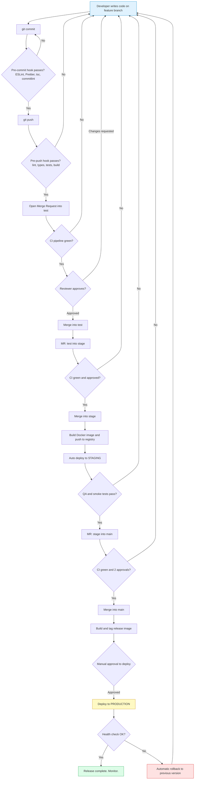

---

## 2. Branching strategy: test → stage → main

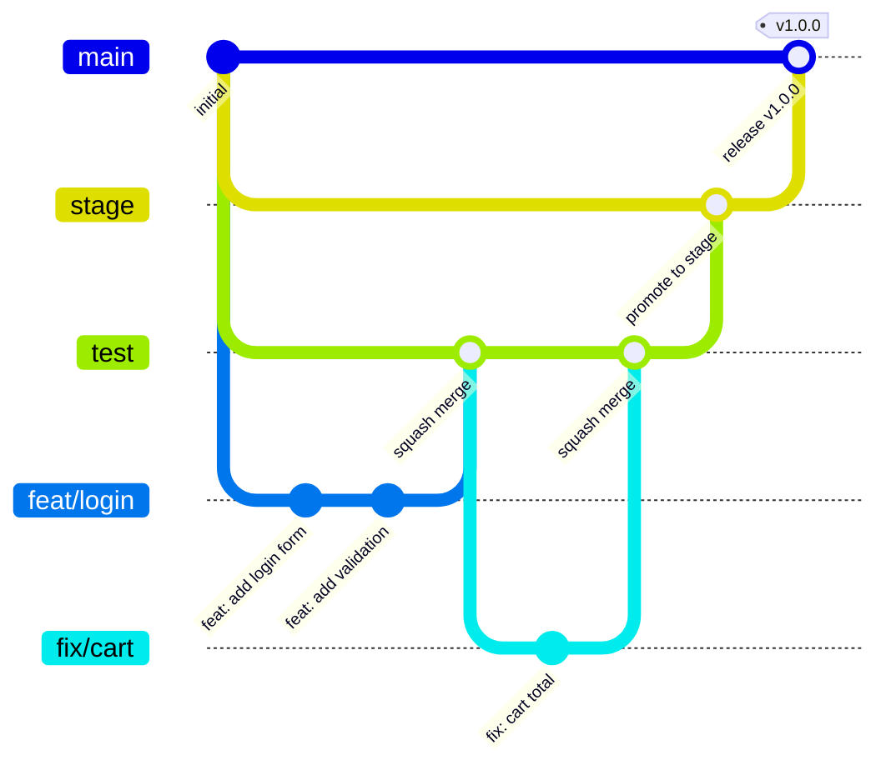

Branch roles at a glance:

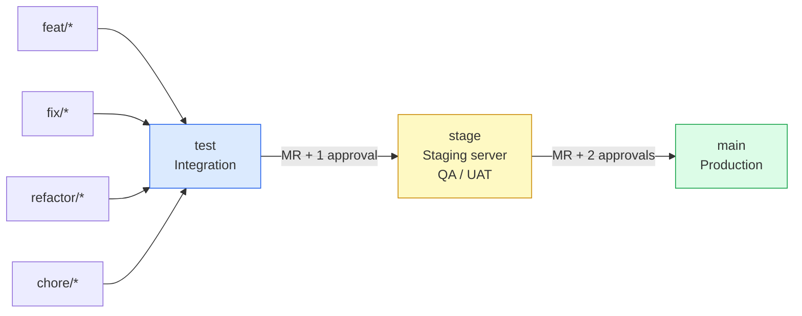

---

## 3. Daily developer workflow

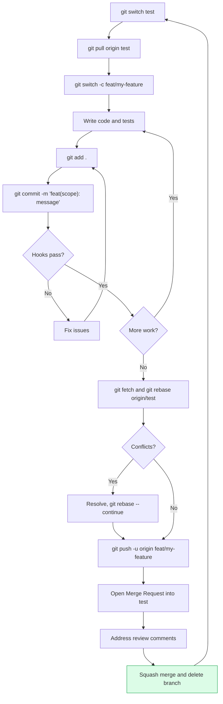

---

## 4. Local gates: commit and push hooks

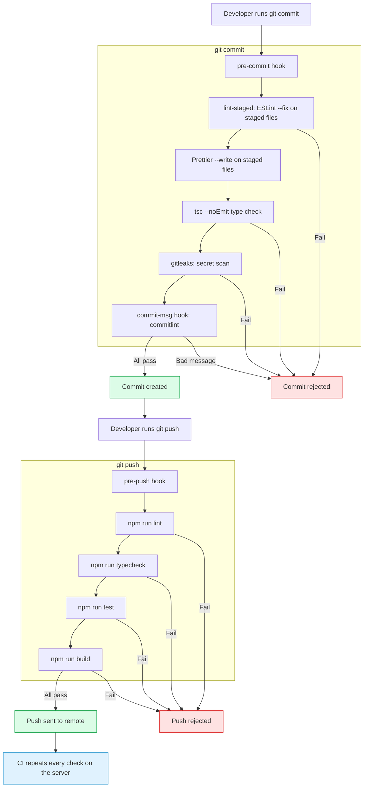

> Hooks can be bypassed with `--no-verify`. CI cannot. That is why both exist.

---

## 5. CI pipeline

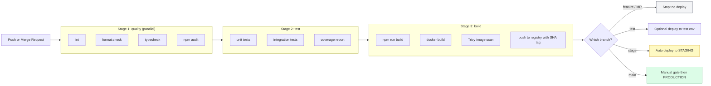

---

## 6. Merge Request, review and protection

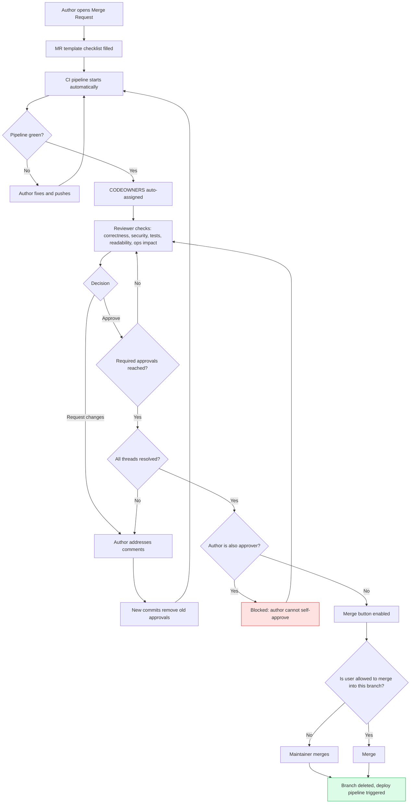

Who can do what:

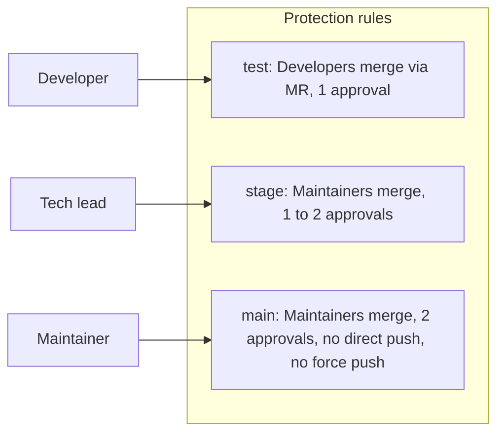

---

## 7. Docker image build

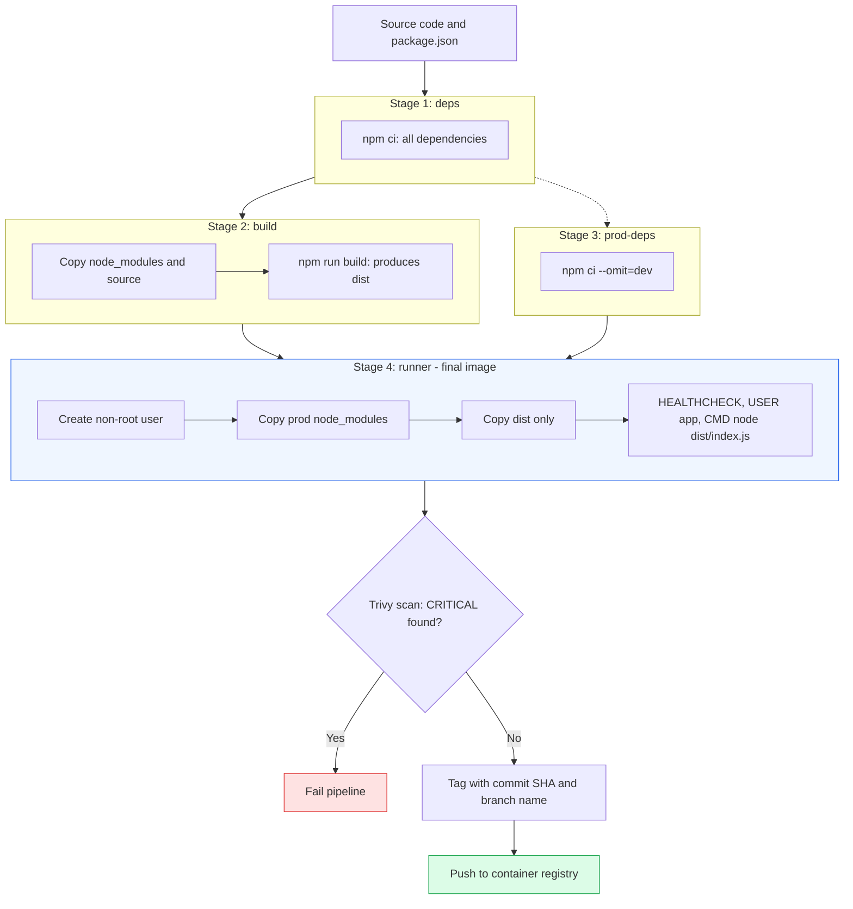

Why multi-stage: the final image has no source code, no dev dependencies, no compilers. It is smaller and has fewer vulnerabilities.

---

## 8. Deployment with automatic rollback

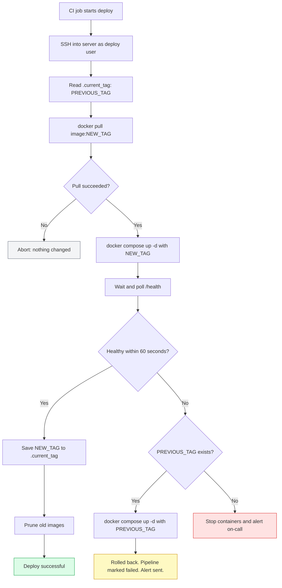

---

## 9. Deploy sequence: who talks to whom

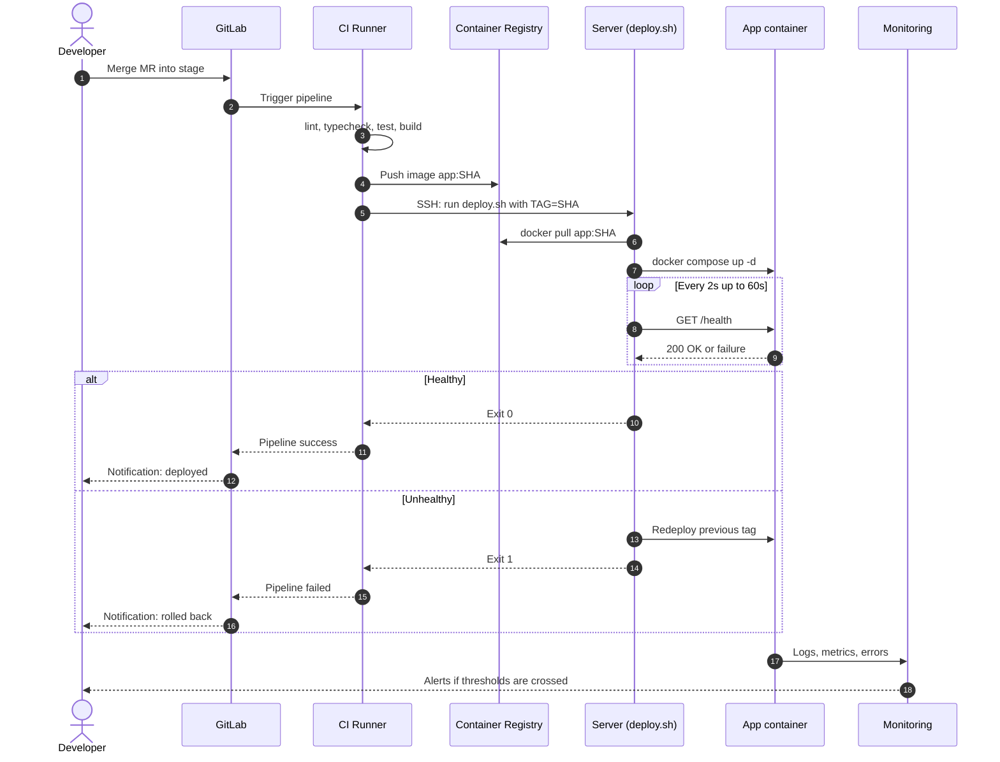

---

## 10. Hotfix flow

Production is broken and cannot wait for the normal `test → stage → main` promotion.

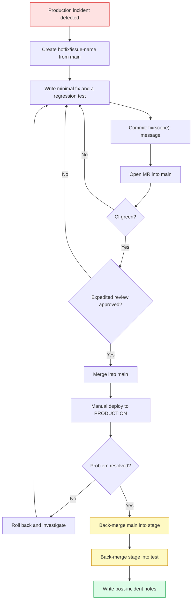

> **Do not skip the back-merge.** Otherwise the fix disappears in the next promotion from `test`.

---

## 11. Production monitoring and incident response

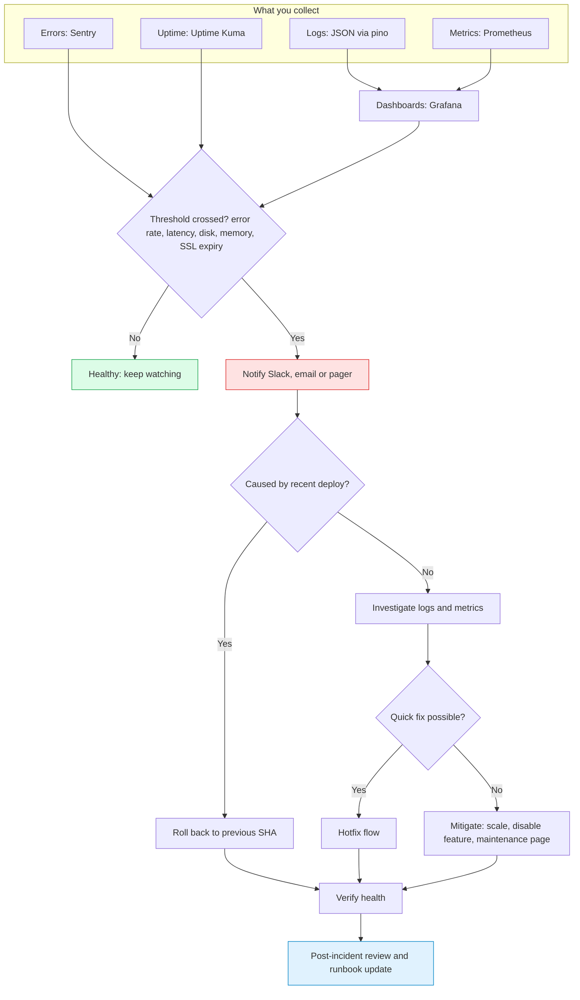

---

## 12. Server architecture

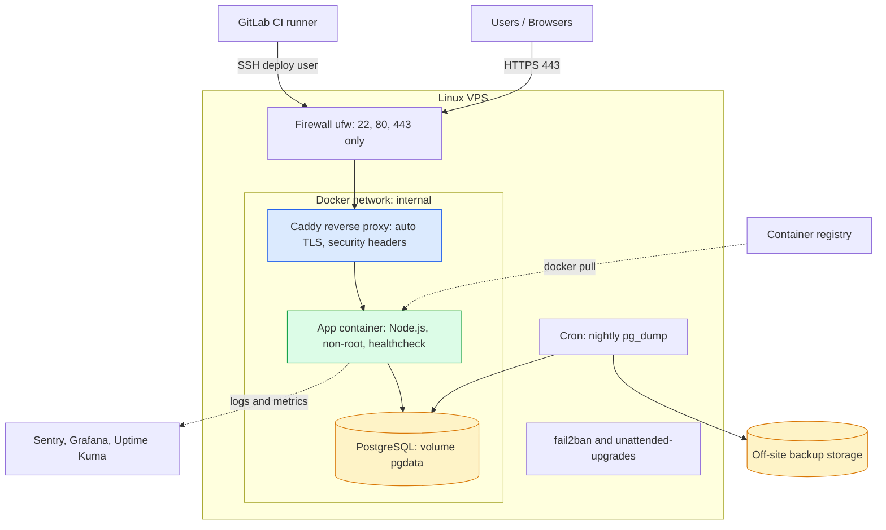

The database is on the internal network only and is never exposed to the internet.

---

## 13. Learning roadmap

```mermaid
flowchart LR
    P1["1. Git fundamentals<br/>branch, rebase, reflog"] --> P2["2. Team workflow<br/>branching, MRs, conventional commits"]
    P2 --> P3["3. Local gates<br/>ESLint, Prettier, tsc, Husky"]
    P3 --> P4["4. CI<br/>GitLab CI jobs, cache"]
    P4 --> P5["5. Protection<br/>protected branches, approvals"]
    P5 --> P6["6. Docker<br/>multi-stage, compose"]
    P6 --> P7["7. Servers<br/>Linux, SSH, firewall, TLS"]
    P7 --> P8["8. CD<br/>registry, deploy, environments"]
    P8 --> P9["9. Operations<br/>logs, metrics, backups, rollback"]
    P9 --> P10["10. Advanced<br/>Terraform, Kubernetes, blue/green"]

    style P1 fill:#e0f2fe,stroke:#0284c7
    style P5 fill:#fef9c3,stroke:#ca8a04
    style P9 fill:#dcfce7,stroke:#16a34a
    style P10 fill:#f3e8ff,stroke:#9333ea
```

Mapping to the 10 practice tasks:

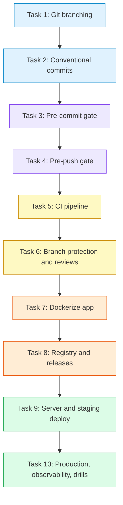

---

## Quick legend

| Shape / color | Meaning |
|---|---|
| Diamond | A decision or gate |
| Rectangle | An action or step |
| Green | Success / finished state |
| Red | Failure / blocked / incident |
| Yellow | Caution, manual step, or approval |
| Blue | Information / start or tooling |
